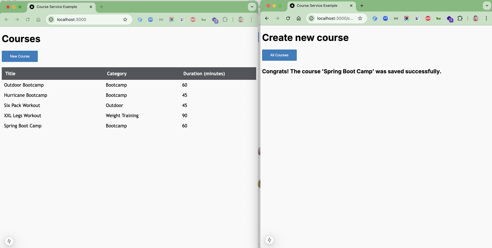
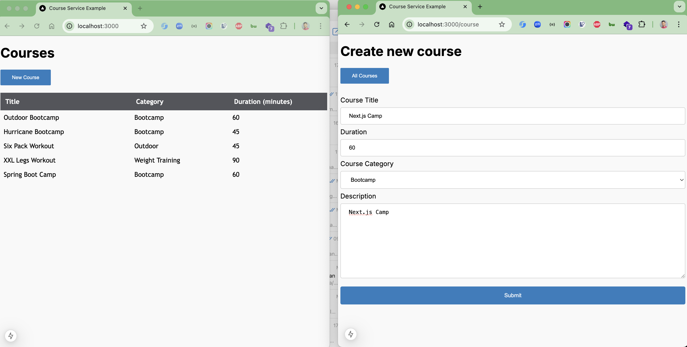
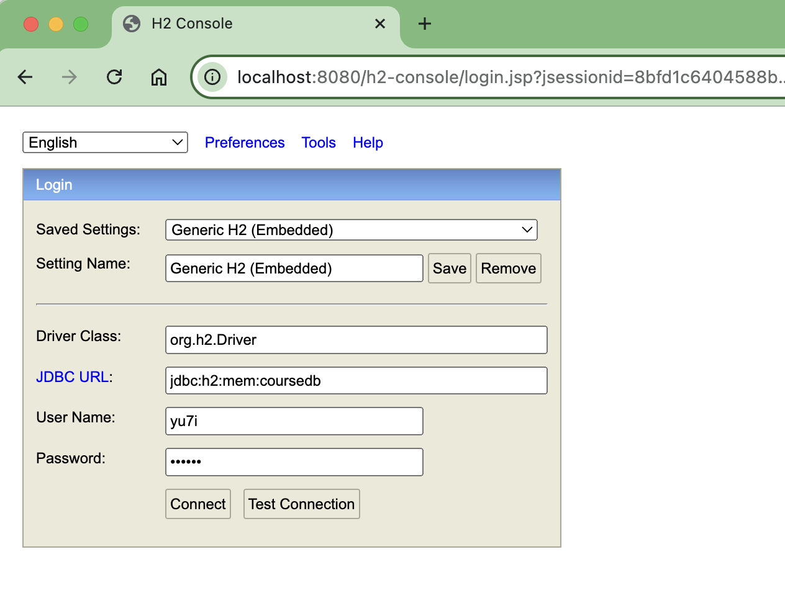
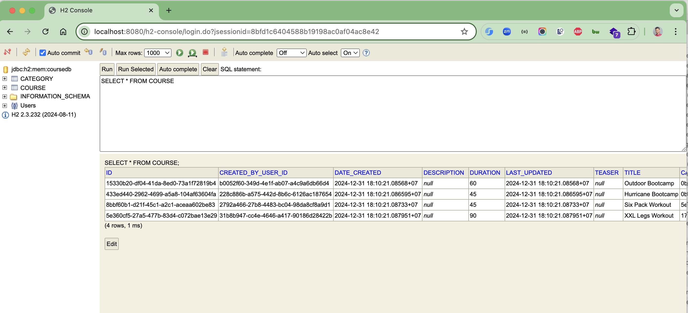
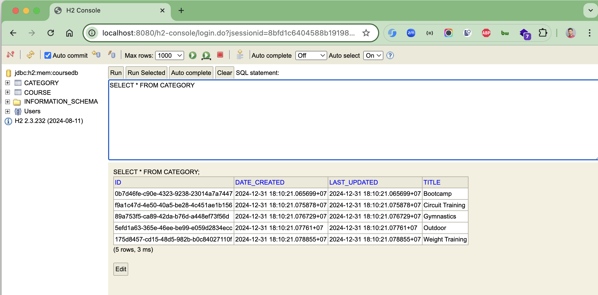

# course-web

[](https://github.com/hendisantika/course-web/actions/workflows/maven.yml)


Course management web app: a Spring Boot REST + SSE backend (H2 in-memory database) with a Next.js frontend.

## Tech Stack

| Layer    | Technology                                                                 |
|----------|----------------------------------------------------------------------------|
| Backend  | Java 25, Spring Boot 4.1 (Web, WebFlux, Data JPA, Validation, Actuator)    |
| Database | H2 (in-memory)                                                             |
| Mapping  | ModelMapper, Lombok                                                        |
| Frontend | Next.js 15, React 18                                                       |
| CI/CD    | GitHub Actions (Maven build + dependency graph), Dependabot                |
| Runtime  | Docker (`eclipse-temurin:25-jre-alpine`)                                   |

## Prerequisites

- JDK 25
- Maven 3.9+ (or use the bundled Maven Wrapper `./mvnw`)
- Node.js 20+ and pnpm (for the frontend)
- Docker (optional)

## Things to do list

1. Clone the repository:
   `git clone https://github.com/hendisantika/course-web.git`
2. Go to the project folder: `cd course-web`
3. Run the backend: `./mvnw clean spring-boot:run`
4. Go to the frontend folder: `cd frontend`
5. Run the frontend: `pnpm install && pnpm dev`
6. Open your favorite browser then type `http://localhost:3000`
7. Open the H2 console at `http://localhost:8080/h2-console` (JDBC URL: `jdbc:h2:mem:coursedb`, credentials in
   `src/main/resources/application.yml`)
8. Enjoy the app!

## Build & Test

```shell
./mvnw clean package
```

The executable JAR is produced in `target/`.

## Docker

```shell
./mvnw clean package -DskipTests
docker build -t course-web .
docker run -p 8080:8080 course-web
```

## Dependency Updates

Dependabot (`.github/dependabot.yml`) keeps dependencies up to date with grouped pull requests for:

- **Maven** (daily): Spring Boot, Maven plugins, and other minor/patch updates
- **npm** for `frontend/` (weekly): React, Next.js, and other minor/patch updates
- **Docker** base image (weekly, stays on the Java 25 line)
- **GitHub Actions** (daily)

## Images Screen shot

Home Page



Add New Course



H2 Console



Course List



Category List


